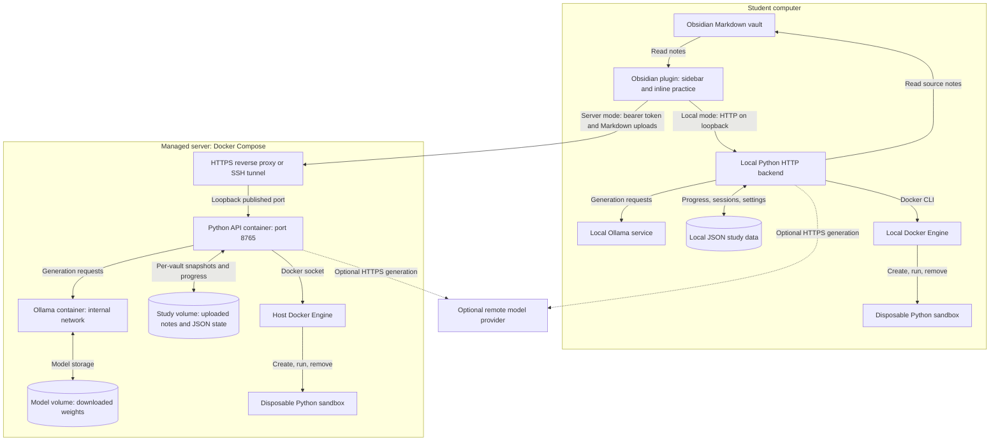
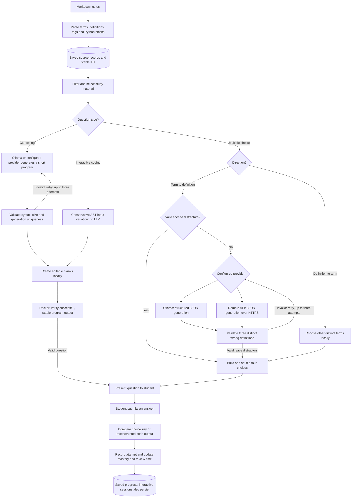

# Deployment and AI pipeline

These diagrams describe the implemented system. Local and managed-server modes
are alternatives. The application performs model inference, not model training.

## Deployment

- The managed API port is published on server loopback. HTTPS termination is an
  administrator-provided reverse proxy; SSH forwarding is the alternative.
- Remote provider keys accompany quiz requests and are not saved. The backend
  token authenticates the plugin separately.
- Only the trusted API container receives the Docker socket. Student sandboxes
  have no network, no vault/socket mounts, a read-only root, an unprivileged user,
  resource limits and enforced cleanup.
- Optional Python packages are installed into dedicated sandbox images.
- The standalone terminal CLI uses the same Python modules, model services,
  JSON storage and sandbox. It can also run in the root Dockerfile's CLI image.

Sources: `deployment/compose.yaml`, both Dockerfiles, `markdown_quiz/api.py`,
`markdown_quiz/services/sandbox.py` and `obsidian-markdown-quiz/src/main.ts`.

## AI and question-generation pipeline

AI generates forward multiple-choice distractors and CLI coding programs.
Reverse multiple choice uses existing terms. Sidebar/inline coding variation and
blank creation use Python ASTs rather than an LLM. Generated programs are checked
and executed inside Docker; an LLM does not grade submitted code.

For interactive coding, missing stdin pauses preparation for program input;
silent or invalid sources are skipped. Wrong coding answers remain retryable.
Interactive multiple choice allows two attempts. Drafts and request IDs support
resume and safe retransmission. Sandbox infrastructure failures do not penalize
the student. Exhausted model retries surface an error for retry/skip handling.

Sources: `notes/parser.py`, `quiz/selection.py`, `quiz/term_quiz.py`,
`quiz/questions.py`, `quiz/code_quiz.py`, `quiz/engine.py` and
`services/ollama.py` / `services/cloud.py` within `markdown_quiz/`.
